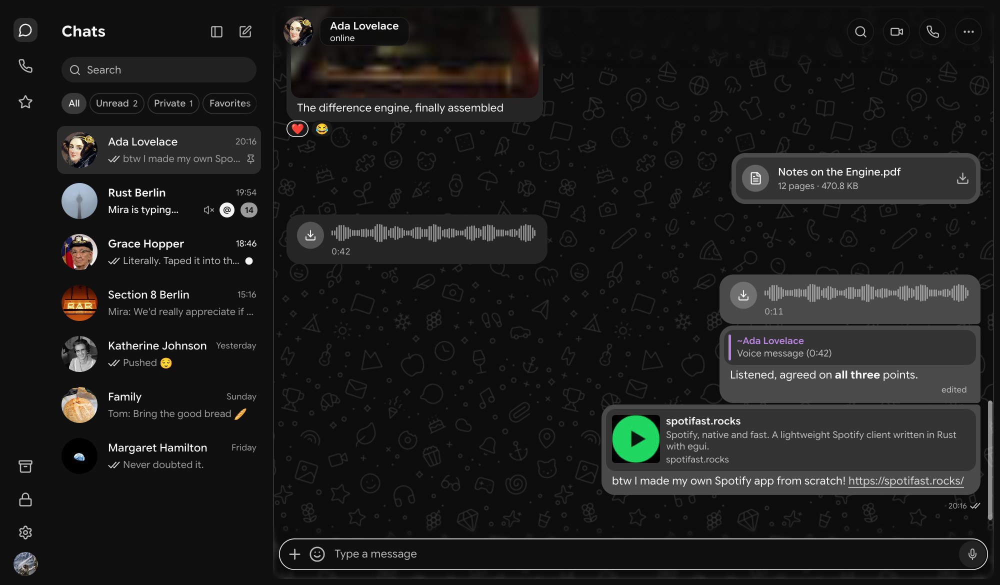
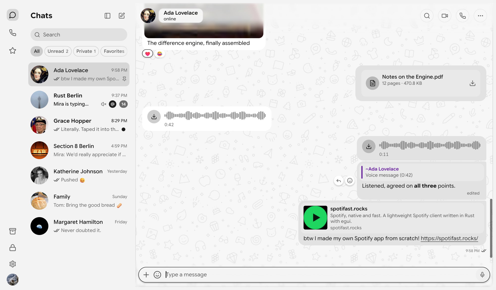

  

<h1 align="center">Zeus</h1>

<strong>WhatsApp, native and fast.</strong> A lightweight desktop WhatsApp client for Windows, macOS, and Linux.

  <a href="https://github.com/ItIsNotKeshav/zapfast/releases/latest"><strong>Download</strong></a> ·
  <a href="#install">Install</a> ·
  <a href="#link-your-phone">Link your phone</a> ·
  <a href="#credits">Credits</a>

  
  
  

Zeus is a fork of [ZapFast](https://github.com/crmne/zapfast) by
[Carmine Paolino](https://github.com/crmne). It is a native WhatsApp app
written in Rust with [egui](https://www.egui.rs), with no browser engine
inside. It links to your phone as a companion device, the way WhatsApp Web
does, and keeps your chats in an encrypted archive on your own computer.

*The screenshots use made-up demo chats, never real conversations.*

## What Zeus is

Zeus follows ZapFast closely and pulls in its fixes and features as they
arrive. On top of that it adds its own name, icon, and Windows installer, and
some interface work: a frosted composer and bars, a sending animation, and a
left-hand navigation rail. It installs beside ZapFast without touching it, with
its own folders, settings, and linked devices.

Everything ZapFast does, Zeus does: text with formatting, replies, edits,
reactions, forwards, media, stickers, GIFs, polls, voice messages, voice and
video calls, several linked numbers in one window, locked chats and an app
lock, and desktop notifications with a tray icon. The interface is in English,
Chinese, French, German, Indonesian, Italian, Portuguese, Russian, Spanish,
and Turkish.

## Install

| Platform | How |
|---|---|
| **Windows** | Download `zeus-<version>-x86_64-setup.exe` from [Releases](https://github.com/ItIsNotKeshav/zapfast/releases/latest). It installs for your user without administrator rights. It is not code-signed, so Windows SmartScreen warns once: choose **More info**, then **Run anyway**. |
| **macOS** | Download the `.tar.gz` for your Mac (Apple Silicon is `aarch64`, Intel is `x86_64`) and run the `zeus` binary. There is no `.app` bundle yet, and the binary is unsigned. |
| **Linux** | Download the `.tar.gz`, unpack it, and run `zeus`. It includes a desktop entry and icon you can copy into place. |
| **From source** | Install Rust, then run `cargo build --release --locked`. Linux needs ALSA, PipeWire, and clang headers, and every platform needs cmake. |

Only the Windows build is tested by the maintainer. The macOS and Linux builds
are produced by GitHub Actions and are not yet tried on real machines, so
please report what you find.

## Link your phone

1. Open Zeus. It shows a QR code.
2. On your phone, open WhatsApp, go to **Linked devices**, and choose **Link a device**.
3. Scan the code. Your recent chats appear, and Zeus asks your phone for older history as you scroll.

Zeus is a companion device, so your phone remains the main account. Your chats
stay in an encrypted archive on this computer, and nothing goes to a server
of ours.

## Guides

Zeus shares ZapFast's behaviour, so the
[ZapFast guides](https://zapfast.rocks/) apply: how linking works, settings
and stored files, shortcuts, and making your own theme. Their screenshots show
ZapFast's name and colours.

## Credits

Zeus exists because of [ZapFast](https://github.com/crmne/zapfast), created
and maintained by **Carmine Paolino** ([@crmne](https://github.com/crmne)) and
its [contributors](https://github.com/crmne/zapfast/graphs/contributors).
The app, its design, and almost all of its code are their work. Please
[star and support the original project](https://github.com/crmne/zapfast).

Zeus also builds on:

- [whatsapp-rust](https://github.com/oxidezap/whatsapp-rust) for the WhatsApp protocol
- [egui](https://www.egui.rs) and [fastframe](https://fastframe.dev) for the interface and desktop integration
- the open-source libraries listed in [THIRD-PARTY-NOTICES.md](THIRD-PARTY-NOTICES.md)

## Disclaimer

Zeus is an unofficial client. It is not affiliated with, endorsed by, or
connected to WhatsApp or Meta. Use it at your own risk: WhatsApp can limit
accounts that use unofficial clients.

## License

MIT. Copyright (c) 2026 Carmine Paolino, and Keshav for the changes in this
fork. See [LICENSE](LICENSE).
